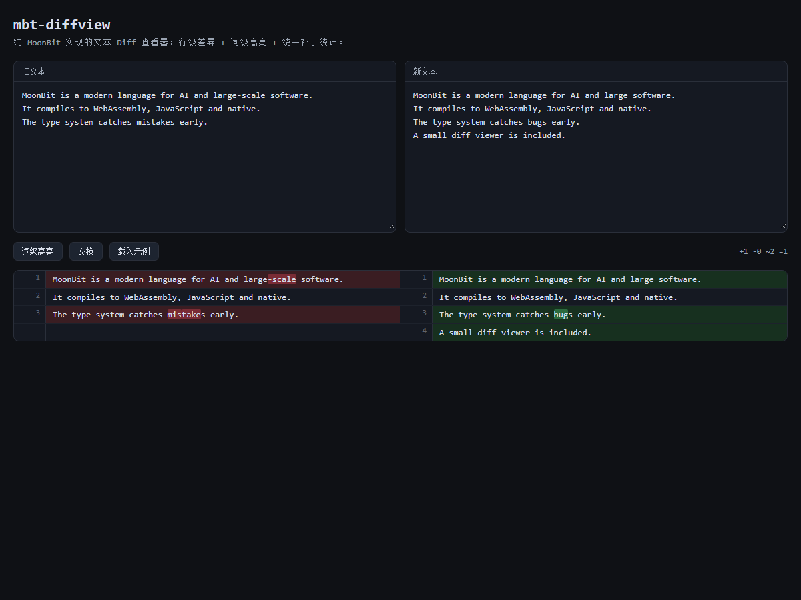

# mbt-diffview

纯 MoonBit 实现的文本 Diff 查看器：**行级差异 + 词级高亮 + 左右对照 + 统一补丁导出**，提供可复用库、CLI 与 Web GUI。



## 特性

- **行级 diff**：基于官方 `moonbitlang/core/diff`，支持 Myers 与 Patience 两种算法
- **词级高亮**：对变更行做字符级 diff，中文、英文、标点都按字符处理
- **左右对照**：旧文本 / 新文本并排显示，带行号与统计
- **统一补丁**：导出标准 `@@ -a,b +c,d @@` 格式，可直接交给 `patch`
- **三种输出**：`text` / `json` / `html`
- **薄 GUI**：Rabbita 只负责输入与渲染，所有 diff 计算都调用核心库
- **零运行时依赖**：核心只依赖 MoonBit 标准库与 `moonbitlang/x` 的文件 API

## 快速开始

### GUI

直接打开：

```text
ui/dist/index.html
```

或在修改 UI 后重新构建：

```bash
moon build ui --target js --release
cp _build/js/release/build/ui/ui.js ui/dist/app.js
```

### CLI

```bash
# 左右对照文本
moon run cmd/main -- examples/old.txt examples/new.txt

# JSON 输出
moon run cmd/main -- --format json examples/old.txt examples/new.txt

# 导出独立 HTML
moon run cmd/main -- --format html --output diff.html examples/old.txt examples/new.txt

# 使用 Patience 算法、关闭词级高亮
moon run cmd/main -- --algorithm patience --no-word-level examples/old.txt examples/new.txt
```

退出码：`0` 相同，`1` 存在差异，`2` 用法或读写错误。

## 库 API

```moonbit
let options = @Mr-Houjie/mbt-diffview.DiffOptions::new()
let result = @Mr-Houjie/mbt-diffview.diff_text(old_text, new_text, options)

println(result.stats.added)
println(result.stats.removed)
println(result.stats.changed)
println(result.stats.unchanged)
println(result.patch) // 标准 unified diff

let text = @Mr-Houjie/mbt-diffview.render_text(result)
let json = @Mr-Houjie/mbt-diffview.render_json(result)
let html = @Mr-Houjie/mbt-diffview.render_html(result, "old.txt", "new.txt")
```

## 架构

```text
types.mbt        公共类型（Row / DiffResult / DiffOptions）
split.mbt        文本切行（统一 LF / CRLF）
worddiff.mbt     字符级 diff 片段
diffcore.mbt     行级 diff 引擎（core/diff -> 左右对照行）
render.mbt       text / json / html 渲染
conformance.mbt  22 条一致性语料（测试与自检共用）
cmd/main         CLI
cmd/verify       独立自检入口
ui/              Rabbita Web GUI（薄层）
```

## 测试

```bash
# 标准测试（Linux / macOS）
moon test

# 独立自检（Windows 下 moon test 可能受嵌套进程限制）
moon run cmd/verify
```

覆盖内容：22 条统计语料、词级片段可还原原行、HTML 转义、JSON 结构、Patience 算法、
固定种子 fuzz 300 轮；另有 8 份真实语料黄金测试（代码 / 配置 / 文档 / 中文 / CSV / 日志 / 相同 / CRLF）：

```bash
moon run cmd/golden
```

## 边界与不做的事

- 只处理文本，不处理二进制文件
- 不做三方合并、不做语法高亮、不做词形还原
- GUI 在浏览器内对大文本逐键重算，适合中小文本；超大文件建议用 CLI
- 换行统一按 `\n` 处理，忽略文件末尾是否有换行

## 许可证

MIT
